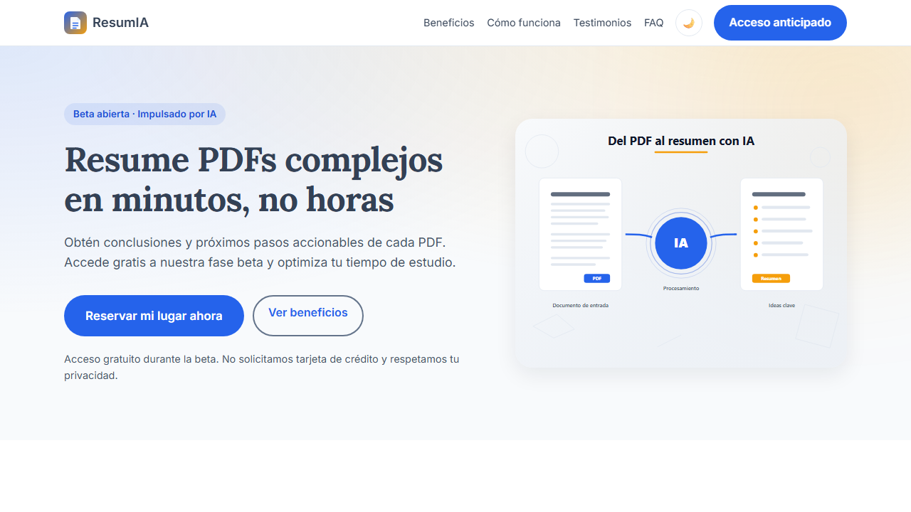

# ResumIA — Landing page de captura para una beta de IA

[](https://kanonufo.github.io/landing-page-ia/)
[](https://developer.mozilla.org/es/docs/Web/HTML)
[](https://developer.mozilla.org/es/docs/Web/CSS)
[](https://developer.mozilla.org/es/docs/Web/JavaScript)
[](docs/unidad3/capturas/lighthouse_report.png)

**ResumIA** es una startup ficticia cuyo producto convierte documentos PDF extensos en resúmenes claros: ideas clave, conclusiones y próximos pasos. Esta landing tiene un único objetivo de conversión: capturar correos para el acceso anticipado a la beta.

Proyecto de la electiva *Landing Pages: Desarrollo web acelerado con Google AI Studio* (Universidad Pedagógica y Tecnológica de Colombia). Construido con HTML5, CSS3 y JavaScript ES6+ puro, con Google AI Studio (Gemini) como asistente y auditoría humana del código generado.



## Demo

- **Sitio publicado:** <https://kanonufo.github.io/landing-page-ia/>
- **Repositorio:** <https://github.com/kanonufo/landing-page-ia>
- **Local:** abre `index.html` o sirve la carpeta con `python -m http.server 8788`.

## Qué incluye

- **Hero** con propuesta de valor, dos CTA e ilustración vectorial.
- **Beneficios** (5 tarjetas) y **cómo funciona** (3 pasos).
- **Testimonios** (3) con prueba social cuantificable.
- **FAQ** con acordeón accesible (`aria-expanded`, teclado, una respuesta abierta).
- **Contador de cohorte** persistente con `localStorage`.
- **Formulario de captura** con validación accesible, autoguardado, restauración, envío externo, limpieza del borrador y estado de usuario convertido.
- **Progreso de lectura** y botón "volver arriba".
- **Modo oscuro** con preferencia persistida y respeto de `prefers-color-scheme`.
- **Aviso legal** y contacto en el pie.

## Persistencia y estado

| Clave | Uso |
|---|---|
| `resumia_form_nombre` | Borrador del nombre. |
| `resumia_form_email` | Borrador del correo. |
| `resumia_form_rol` | Perfil seleccionado. |
| `resumia_form_consentimiento` | Decisión de consentimiento. |
| `resumia_usuario_convertido` | Marca de conversión. |
| `resumia_usuario_nombre` | Nombre para el agradecimiento. |
| `resumia_countdown_fin` | Fecha de cierre de la cohorte. |
| `resumia_tema` | Tema claro/oscuro. |

El envío se realiza con `fetch` al endpoint declarado en `data-endpoint` del formulario. En la demo se usa `https://httpbin.org/post` para verificar el `POST` y la respuesta 200; para producción basta con cambiarlo por `https://formspree.io/f/TU_ID`.

## Sistema de diseño y snippets

- **32 custom properties** en `:root` y tema oscuro por redefinición de tokens.
- Convención `resumia-[componente]__[elemento]--[estado]`.
- Cuatro snippets con IIFE y script al final del body: hero, FAQ, contador y progreso de lectura.
- Sin frameworks, sin librerías y sin build.

## Tecnologías y calidad

- HTML5 semántico validado en W3C.
- CSS mobile-first con BEM, breakpoints en 480 / 768 / 1200 y `prefers-reduced-motion`.
- JavaScript ES6+ (`const`/`let`, funciones nombradas, `fetch`, `async/await`, `IntersectionObserver`).
- Accesibilidad WCAG 2.1 AA: contraste, foco visible, etiquetas, regiones de error y navegación por teclado.
- Lighthouse: Performance 97–100, Accessibility 100, Best Practices 100, SEO 100.
- Consola sin errores ni respuestas 4xx.

## Proceso de desarrollo (5 fases)

1. **Exploración:** buyer persona y dolores del público académico.
2. **Definición:** arquitectura de secciones y copy del hero.
3. **Generación:** HTML/CSS/JS con Gemini en Google AI Studio.
4. **Refinamiento:** accesibilidad, responsive, rendimiento y auditoría del código.
5. **Consolidación:** persistencia, sistema de componentes, documentación y despliegue.

Los prompts se conservan en [`docs/prompts.md`](docs/prompts.md) y [`docs/unidad3/prompts_unidad3.md`](docs/unidad3/prompts_unidad3.md).

## Estructura

```text
.
├── index.html
├── styles.css
├── assets/
│   ├── js/
│   │   ├── core.js                 # tema, cabecera, animaciones, año
│   │   ├── form-persistence.js     # autoguardado, restauración, envío, convertido
│   │   ├── faq.js                  # acordeón accesible
│   │   ├── countdown.js            # contador persistente
│   │   └── scroll-progress.js      # progreso de lectura y volver arriba
│   ├── images/hero_resumia_v2.svg
│   └── icons/favicon.svg
├── docs/
│   ├── prompts.md, diario_prompts.md, planificacion.md, brief.md
│   ├── capturas/                   # evidencias de la Unidad 2
│   └── unidad3/
│       ├── E30_repositorio/        # reflexión + Issues y Kanban (PDF)
│       ├── E31_auditoria/          # informe + código original/corregido
│       ├── E32_persistencia/       # diseño + video + guion
│       ├── E33_sistema/            # sistema de diseño
│       ├── E34_memoria/            # memoria + guion de presentación
│       ├── capturas/               # consola, Application, Network, Lighthouse, responsive
│       └── media/                  # diagramas y portadas SVG/PNG
└── README.md
```

## Cómo personalizar

1. **Marca y copy:** edita los textos de `index.html` y los SVG de `assets/images` y `assets/icons`.
2. **Paleta y tipografía:** cambia los tokens de `:root` en `styles.css`; el tema oscuro se ajusta en `[data-tema="oscuro"]`.
3. **Endpoint del formulario:** modifica `data-endpoint` en `<form id="formulario">`.
4. **Cohorte:** la fecha se guarda en `resumia_countdown_fin`; para reiniciarla, borra esa clave en DevTools.
5. **Claves de persistencia:** mantén el prefijo `resumia_` para evitar colisiones.

## Entregables de la Unidad 3

- **E3.0:** [`reflexion_repositorio.pdf`](docs/unidad3/E30_repositorio/reflexion_repositorio.pdf) · [`issues_y_project.pdf`](docs/unidad3/E30_repositorio/issues_y_project.pdf)
- **E3.1:** [`informe_auditoria.pdf`](docs/unidad3/E31_auditoria/informe_auditoria.pdf) · [`codigo_original.html`](docs/unidad3/E31_auditoria/codigo_original.html) · [`codigo_corregido.html`](docs/unidad3/E31_auditoria/codigo_corregido.html)
- **E3.2:** [`diseno_persistencia.pdf`](docs/unidad3/E32_persistencia/diseno_persistencia.pdf) · [`demo_persistencia.mp4`](docs/unidad3/E32_persistencia/demo_persistencia.mp4) · [`guion_video.pdf`](docs/unidad3/E32_persistencia/guion_video.pdf)
- **E3.3:** [`sistema_diseno.pdf`](docs/unidad3/E33_sistema/sistema_diseno.pdf)
- **E3.4:** [`memoria.pdf`](docs/unidad3/E34_memoria/memoria.pdf) · [`presentacion_resumia.pptx`](docs/unidad3/E34_memoria/presentacion_resumia.pptx) · [`guion_presentacion_literal.pdf`](docs/unidad3/E34_memoria/guion_presentacion_literal.pdf)

## Créditos

Proyecto académico de la Universidad Pedagógica y Tecnológica de Colombia. Copy, estructura y código generados con asistencia de Google AI Studio (Gemini) y revisados, corregidos y documentados por el estudiante. Tipografías Lora e Inter de Google Fonts. Ilustraciones y diagramas vectoriales propios.

---

**Nota académica:** el sitio es una demostración. El formulario envía los datos a un servicio HTTP externo para verificar el flujo; no se usan para publicidad ni se comparten con terceros.
