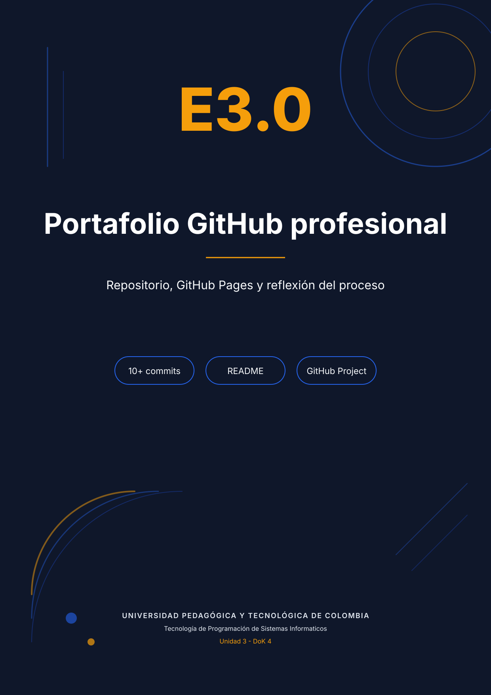

<div class="portada"></div>

# E3.0 — Evidencias de gestión: Issues y tablero Kanban

**Repositorio:** <https://github.com/kanonufo/landing-page-ia>
**Sitio:** <https://kanonufo.github.io/landing-page-ia/>

## 1. Issues registrados

| N.º | Título | Etiqueta | Estado | Cierre |
|---|---|---|---|---|
| [#1](https://github.com/kanonufo/landing-page-ia/issues/1) | [BUG] Recurso del hero devuelve 404 por ruta de imagen desactualizada | `bug` | Cerrado | Commit que publica `hero_resumia_v2.svg` y actualiza el `src`. |
| [#2](https://github.com/kanonufo/landing-page-ia/issues/2) | [MEJORA] Evitar que las tipografías de Google bloqueen el render | `mejora` | Cerrado | Commit que añade `preload` y carga no bloqueante. |
| [#3](https://github.com/kanonufo/landing-page-ia/issues/3) | [TAREA] Implementar autoguardado y restauración del formulario | `tarea` | Cerrado | Commit del módulo `form-persistence.js`. |
| [#4](https://github.com/kanonufo/landing-page-ia/issues/4) | [MEJORA] Añadir sección FAQ con acordeón accesible | `mejora` | Cerrado | Commit de `faq.js` y la sección FAQ. |
| [#5](https://github.com/kanonufo/landing-page-ia/issues/5) | [BUG] Enlace mailto del aviso legal sin contraste AA | `bug` | Cerrado | Commit que fija el color del enlace y lleva Accessibility a 100. |
| [#6](https://github.com/kanonufo/landing-page-ia/issues/6) | [TAREA] Documentar prompts, auditoría y memoria de la Unidad 3 | `documentacion` | Abierto | En curso durante la entrega. |

Los Issues reflejan problemas reales del desarrollo: un 404 que rompía la ilustración del hero, una fuente que bloqueaba el render, un enlace con contraste insuficiente, la ausencia de persistencia y la falta del acordeón. Cada uno tiene título descriptivo, cuerpo con pasos o criterio de cierre, etiqueta y referencia al cambio que lo resolvió.

## 2. Tablero Kanban (8 tareas)

| Tarea | Columna | Criterio de verificación |
|---|---|---|
| Publicar `hero_resumia_v2.svg` y corregir el 404 | Completado | Cero respuestas 4xx en la pestaña Network. |
| Carga no bloqueante de tipografías | Completado | Lighthouse Performance ≥ 70 y sin cambios visuales. |
| Módulo de persistencia con claves `resumia_form_*` | Completado | Autoguardado y restauración probados con DevTools. |
| Lógica de usuario convertido y limpieza del borrador | Completado | Tras el envío solo quedan las claves de estado. |
| Envío `POST` con `fetch` y manejo de errores | Completado | Respuesta 200 y cuerpo verificado en Network. |
| Acordeón FAQ accesible | Completado | Apertura con teclado y `aria-expanded` correcto. |
| Contador de cohorte persistente | Completado | La fecha no se reinicia al recargar. |
| Documentación E3.0–E3.4 y evidencias | En revisión | PDFs, capturas y video adjuntos. |

El tablero se mantiene en el repositorio como registro verificable. La creación del Project (v2) en GitHub requiere el permiso `project` del token; el token disponible solo tiene `repo`, `gist`, `read:org` y `workflow`. Por eso el tablero se entrega como tabla y se deja el procedimiento para publicarlo con la cuenta propietaria:

```bash
gh auth refresh -s project,read:project
gh project create --owner kanonufo --title "ResumIA - Unidad 3"
gh project item-add <PROJECT_ID> --owner kanonufo --url <URL_DEL_ISSUE>
```

## 3. Historial de commits

El repositorio usa Conventional Commits. La Unidad 3 añade confirmaciones separadas por responsabilidad:

```text
feat(persistencia): autoguardado, restauración y usuario convertido
feat(snippets): acordeón FAQ, contador y progreso de lectura
style(sistema): tokens y convención resumia-* aplicados a los snippets
fix(a11y): contraste del enlace legal y consola sin errores
docs(e31): código original, código corregido e informe de auditoría
docs(e32): diseño de persistencia, prompts y video de demostración
docs(e33): sistema de diseño y CREDA por snippet
docs(e34): memoria de proceso y guion de presentación
```

Cada mensaje indica qué cambió y por qué; el historial se lee como una bitácora del producto, no como una lista de "update".

## 4. README y despliegue

El README incluye título y descripción del producto, captura de la landing, badge y URL de GitHub Pages, tecnologías, proceso de cinco fases, instrucciones de personalización, estructura de archivos y créditos. GitHub Pages publica la rama `master`; la URL responde públicamente y es la misma que se entrega en Moodle.
