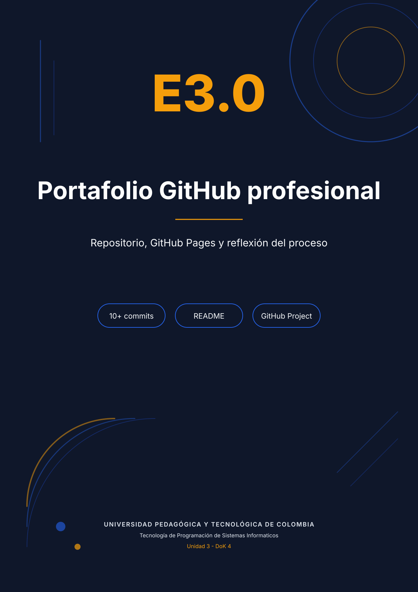

# E3.0 — Portafolio GitHub profesional

**Proyecto:** ResumIA — landing page de captura de leads para una beta de resúmenes de PDF con IA.
**Repositorio:** <https://github.com/kanonufo/landing-page-ia>
**Sitio publicado:** <https://kanonufo.github.io/landing-page-ia/>
**Tablero Kanban:** <https://github.com/users/kanonufo/projects/3>
**Nivel:** DoK 4 — Pensamiento extendido.

## 1. El repositorio como narrativa técnica

Un repositorio no es un ZIP con fecha. Es una narración verificable: cada confirmación registra una decisión, cada rama ensaya una hipótesis y cada Issue deja constancia de un problema real. En ResumIA esa narrativa se construyó con commits en formato Conventional Commits (`feat:`, `fix:`, `style:`, `refactor:`, `docs:`, `chore:`), mensajes específicos y un README que funciona como portada del producto. El historial permite reconstruir la evolución sin abrir el código: primero la identidad visual, después el copy, luego la accesibilidad, más tarde la validación, el modo oscuro y, en la Unidad 3, la persistencia, los snippets y la auditoría.

El repositorio incluye la landing (`index.html`, `styles.css`, `assets/js/*.js`), los recursos gráficos, la documentación de las cinco fases y las evidencias de cada entregable. La rama `unidad-3` se utilizó para aislar el trabajo de refinamiento y se integró a `master` una vez verificadas las pruebas de consola, accesibilidad y rendimiento.

## 2. README como portada profesional

El README cumple seis funciones: presenta el producto y su propuesta de valor; muestra una captura de la landing publicada; expone el badge y la URL activa de GitHub Pages; declara la pila técnica (HTML5, CSS3, JavaScript ES6+ y Google AI Studio/Gemini); describe el proceso de desarrollo en cinco fases; y explica cómo personalizar el proyecto. Además incorpora créditos, estructura de archivos y el registro de prompts. Un lector externo puede entender qué se construyó, cómo se construyó y dónde verlo en menos de dos minutos.

## 3. Gestión visible del trabajo

El tablero Kanban se organizó en cuatro columnas —Por hacer, En progreso, En revisión y Completado— con tareas verificables: implementar autoguardado, restaurar el borrador, integrar el envío externo, documentar los prompts, medir Lighthouse, revisar accesibilidad y preparar la memoria. Los Issues se etiquetaron con prefijos `[BUG]`, `[MEJORA]` y `[TAREA]`; los cerrados citan la confirmación que los resolvió. Esa trazabilidad entre problema, cambio y verificación es la diferencia entre "tener código" y "gestionar un proyecto".

## 4. GitHub Pages como contrato público

Publicar en GitHub Pages convierte la entrega en un contrato verificable: la URL debe responder, la versión desplegada debe coincidir con la última confirmación y el sitio debe funcionar en móvil y escritorio. Esa presión cambió decisiones concretas: se eliminaron recursos que provocaban errores 404, se hizo no bloqueante la carga de tipografías, se corrigió el contraste de los enlaces legales y se verificó que las rutas relativas funcionaran bajo el subdirectorio del repositorio, no solo en local.

## 5. Reflexión: qué cambia cuando el historial es público

Cuando cada cambio queda registrado públicamente, la relación con el código cambia en tres dimensiones. Primero, cambia la unidad de trabajo: ya no se piensa en "guardar el archivo", sino en "explicar un cambio". Un mensaje como `fix(a11y): corregir contraste de enlaces legales` obliga a nombrar el problema y el alcance antes de tocar el código. Segundo, cambia el costo del atajo: un parche silencioso queda expuesto para siempre; en cambio, un commit pequeño, probado y reversible transmite criterio profesional. Tercero, cambia la relación con el futuro: el historial se vuelve documentación operativa para uno mismo y para cualquier otra persona que herede el proyecto.

Tener un historial visible me hizo reconsiderar decisiones técnicas que en local habría tomado sin pensar. Por ejemplo, dudé antes de reemplazar `script.js` por cinco módulos: el cambio era más ruidoso, pero permitía que cada snippet tuviera una IIFE y un archivo propio, y que el commit explicara esa separación. También reconsideré el uso de un endpoint de demostración: en lugar de ocultar la dependencia externa, la documenté en el README y en el código para que la configuración de producción fuera explícita. Y reconsideré el orden de los commits: separar estilos, comportamiento y documentación produjo un historial legible que un evaluador puede seguir sin ayuda.

Trabajar solo en el computador enseña a programar; trabajar con historial público enseña a gestionar. En un proyecto real, el repositorio es el punto de coordinación entre desarrollo, revisión, despliegue y soporte. Aprendí que una rama no es un adorno, que un Issue sin criterio de cierre es una promesa vacía, que un README desactualizado es un bug de comunicación y que una URL caída es un fallo del producto, no de la infraestructura. Aprendí, sobre todo, que la calidad no está solo en el resultado visual: está en la posibilidad de auditar cómo se llegó a él. Ese es el aprendizaje transferible que me llevo de este entregable: construir de forma que otra persona pueda entender, reproducir y continuar el trabajo sin depender de mi memoria.
