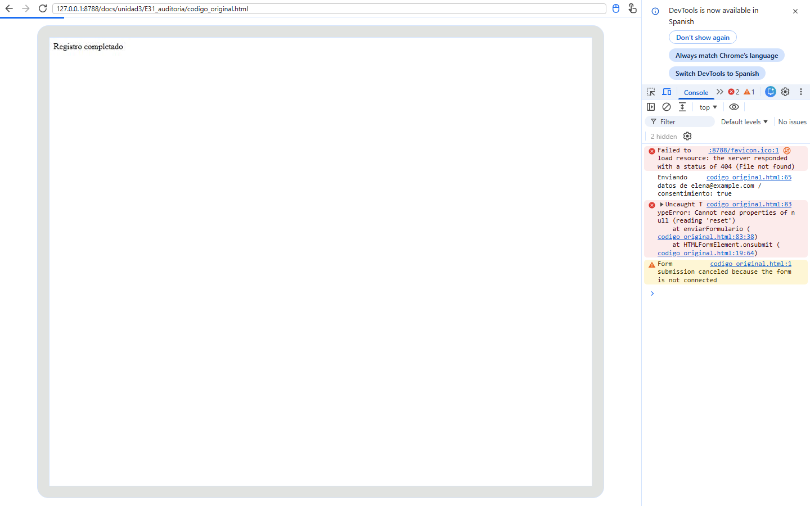
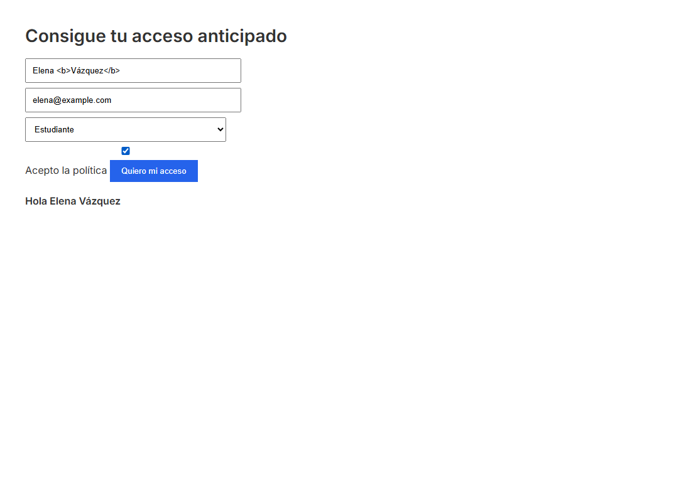
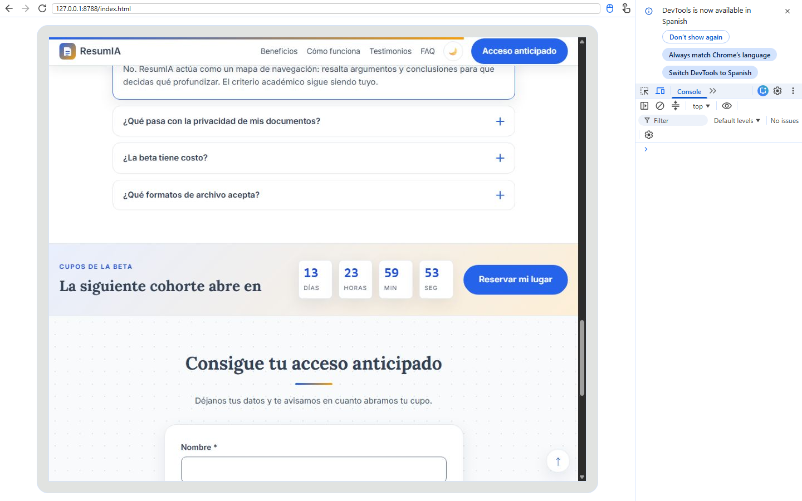

<div class="portada"></div>

# E3.1 — Informe de auditoría crítica del código generado por IA

**Proyecto:** ResumIA — landing page de captura de leads.
**Sección auditada:** formulario de registro con validación, persistencia y envío externo (la sección de mayor complejidad JavaScript).
**Nivel:** DoK 4 — Pensamiento extendido.

## Sección 1 — Contexto de la generación

El código original se solicitó en una sesión nueva de Google AI Studio (Gemini), sin refinamientos previos, con el siguiente prompt inicial:

```text
[ROL] Actúa como desarrollador frontend senior.
[CONTEXTO] Estoy construyendo la landing page de ResumIA, un producto ficticio que
resume PDFs con IA. El objetivo único es capturar correos para la beta.
[TAREA] Genera la sección de registro completa: formulario con nombre, correo,
perfil y consentimiento; validación en JavaScript; autoguardado en localStorage;
restauración al cargar; envío a un servicio externo; mensaje de éxito.
[RESTRICCIONES] HTML, CSS y JavaScript vanilla. Sin frameworks ni librerías.
[FORMATO] Devuelve un único archivo HTML con estilos y script incluidos.
```

Configuración: modelo Gemini en su versión disponible en la interfaz, temperatura por defecto (1.0), una sola ejecución sin ejemplos previos. El resultado completo se conserva en `codigo_original.html` y se reproduce en el Anexo A. La sección elegida concentra validación, estado, almacenamiento, red y DOM: es el punto donde un error tiene mayor impacto sobre la conversión y la privacidad.

## Sección 2 — Inventario de hallazgos

| N.º | Línea(s) | Fragmento problemático (textual) | Tipología | Severidad | Impacto si se despliega |
|---|---|---|---|---|---|
| 1 | 49 | `document.getElementById("saludo").innerHTML = "Hola " + nombre.value;` | Seguridad | Crítico | XSS: un nombre con HTML se interpreta en el DOM. Permite inyectar marcado y, con un payload adecuado, ejecutar script en el origen. |
| 2 | 73 | `xhr.open("POST", "https://httpbin.org/post", false);` | Desactualizado / Rendimiento | Crítico | XHR síncrono bloquea el hilo principal; el navegador lo desaconseja y la interfaz se congela hasta que responde la red. |
| 3 | 81-83 | `document.write("<p>Registro completado</p>");` … `document.getElementById("form").reset();` | Desactualizado / Lógica | Crítico | `document.write` tras la carga reemplaza el documento; el formulario desaparece y la línea siguiente lanza `TypeError` porque `form` ya no existe. |
| 4 | 65 | `console.log("Enviando datos de " + email.value + " / consentimiento: " + consentimiento.checked);` | Seguridad | Crítico | Expone correo y decisión de consentimiento en la consola y en cualquier registro de diagnóstico o soporte. |
| 5 | 42-44 | `localStorage.setItem("nombre", …); localStorage.setItem("email", …);` | Calidad | Moderado | Sin `try/catch`, el modo privado o una cuota llena pueden lanzar una excepción y romper el flujo. Sin namespace, colisiona con otras claves. |
| 6 | 50 | `nombre.addEventListener("keyup", guardar);` dentro de `render()` | Rendimiento / Lógica | Moderado | Cada pulsación añade un listener nuevo: se acumulan decenas de manejadores idénticos y el trabajo crece sin límite. |
| 7 | 35-38, 54 | `var nombre = …; if (e.keyCode == 13)` | Desactualizado | Menor | `var`, comparación laxa y `keyCode` pertenecen a patrones obsoletos; `keyCode` está en desuso y falla con teclados no convencionales. |
| 8 | 8 | `@import url("https://fonts.googleapis.com/…");` | Rendimiento | Moderado | `@import` bloquea el render y encadena la descarga de la fuente; empeora FCP/LCP en móvil. |
| 9 | 68 | `alert("Falta el correo");` | Calidad | Menor | Diálogo modal bloqueante, sin contexto ni asociación con el campo; mala experiencia y no accesible. |
| 10 | 72-83 | Bloque `xhr.send(...)` sin `try/catch`, sin `onerror` y sin comprobar estado | Calidad | Moderado | Un fallo de red o un código 4xx/5xx se trata como éxito; el usuario no recibe diagnóstico y los datos pueden perderse. |
| 11 | 20-28 | `<input id="nombre" placeholder="Nombre">` sin `<label>` ni `aria-describedby` | Lógica / Accesibilidad | Moderado | El campo no tiene nombre accesible estable; el placeholder desaparece al escribir y los errores no se anuncian. |
| 12 | 94-96 | `nombre.value = localStorage.getItem("nombre");` | Lógica | Menor | Si la clave no existe, el input recibe la cadena `"null"`; la restauración no distingue ausencia de valor vacío. |
| 13 | 19 | `onsubmit="enviarFormulario(); return false;"` | Calidad / Seguridad | Menor | Mezcla estructura y comportamiento; impide una CSP estricta y dificulta el mantenimiento. |
| 14 | 87-90 | `document.body.offsetHeight` dentro del evento `scroll` | Rendimiento | Menor | Fuerza recálculos de layout en cada evento; produce *layout thrashing* y consumo innecesario. |

**Síntesis:** 4 hallazgos críticos, 6 moderados y 4 menores. Los críticos no son estilísticos: afectan seguridad (XSS y fuga de datos), integridad del documento y bloqueo de la interfaz.

## Sección 3 — Ciclo AVIA aplicado

### Analizar (antes de ejecutar)

La lectura estática permitió detectar los catorce hallazgos antes de abrir el navegador. El análisis se centró en cuatro preguntas: ¿qué datos del usuario entran al DOM?, ¿qué llamadas de red bloquean o fallan en silencio?, ¿qué estado sobrevive a la recarga?, ¿qué eventos se registran más de una vez? El inventario de la Sección 2 es el resultado de esa etapa.

### Verificar (ejecución real y consola)

El archivo se ejecutó en Chrome con DevTools abierto. La consola registró exactamente lo siguiente:

```text
Failed to load resource: the server responded with a status of 404 (File not found)
Enviando datos de elena@example.com / consentimiento: true
Uncaught TypeError: Cannot read properties of null (reading 'reset')
    at enviarFormulario (codigo_original.html:83:38)
    at HTMLFormElement.onsubmit (codigo_original.html:1:64)
Form submission canceled because the form is not connected
```



La verificación confirmó tres cosas que el análisis estático anticipaba: el correo se imprime en consola; `document.write` destruye el documento; y el `reset()` posterior falla porque el formulario ya no existe. También apareció un 404 de `favicon.ico`, evidencia de que el archivo no declara icono. El saludo con el nombre `Elena <b>Vázquez</b>` se renderizó con la negrita aplicada, prueba visible de la inyección de marcado:



### Iterar (intervenciones)

Se combinaron correcciones manuales y prompts de corrección. Los prompts se documentan textualmente:

```text
[PROMPT DE CORRECCIÓN 1 — seguridad]
El saludo usa innerHTML con datos del usuario. Reescribe esa parte para que el nombre
se trate como texto, no como HTML, y explica por qué textContent elimina el XSS.
Mantén el resto del comportamiento.

[PROMPT DE CORRECCIÓN 2 — red y estado]
Sustituye el XMLHttpRequest síncrono por fetch asíncrono con await, AbortController
y comprobación de response.ok. No uses document.write. Si el envío falla, conserva
los datos y muestra un mensaje accesible.

[PROMPT DE CORRECCIÓN 3 — persistencia]
Guarda cada campo con una clave namespaced resumia_form_*, envuelve localStorage en
try/catch, restaura solo si el valor existe y añade una marca resumia_usuario_convertido
para no volver a mostrar el formulario a quien ya se registró.
```

Las correcciones manuales completaron lo que el modelo no resolvió: etiquetas asociadas, `aria-describedby` por campo, región de estado con `aria-live`, honeypot anti-spam y eliminación de listeners duplicados. El código corregido se entrega en `codigo_corregido.html`.

### Ajustar (prompt base actualizado)

El prompt base se reescribió para prevenir la recurrencia:

```text
[ROL] Desarrollador frontend senior especializado en accesibilidad y seguridad.
[CONTEXTO] Landing page estática para GitHub Pages; formulario de captura de leads.
[TAREA] Genera el formulario y su lógica.
[RESTRICCIONES OBLIGATORIAS]
- Nada de innerHTML con datos de usuario: usar textContent o createElement.
- Nada de XHR síncrono ni document.write: fetch + async/await + AbortController.
- localStorage siempre dentro de try/catch y con claves namespaced.
- Prohibido registrar datos personales en consola.
- Etiquetas <label for>, aria-describedby, role="alert" y aria-live.
- Script al final del body, dentro de una IIFE, en modo estricto.
- Comprobar response.ok y manejar errores de red sin perder el borrador.
[FORMATO] HTML + CSS + JS separados y comentados.
```

## Sección 4 — Código corregido y comparación

El código corregido completo está en `codigo_corregido.html`. Usa `const`/`let`, modo estricto, IIFE, `textContent`, `fetch` asíncrono con `AbortController`, `try/catch` en almacenamiento, claves con namespace, validación accesible y estado de usuario convertido. La consola queda sin errores ni advertencias:



### Comparación de los tres hallazgos más críticos

| N.º | Antes | Después | Por qué la corrección es la adecuada |
|---|---|---|---|
| 1 | `saludo.innerHTML = "Hola " + nombre.value;` | `exitoTexto.textContent = "Gracias, " + nombre + ".";` | `textContent` inserta una cadena de texto y nunca analiza etiquetas. Elimina la superficie de XSS sin perder el saludo personalizado. |
| 2 | `xhr.open("POST", url, false); xhr.send(...);` | `await fetch(url, { method: "POST", signal: control.signal, ... }); if (!respuesta.ok) throw ...` | `fetch` no bloquea el hilo, `await` ordena el flujo y `response.ok` obliga a distinguir éxito de error. `AbortController` evita esperas infinitas. |
| 3 | `document.write("<p>Registro completado</p>"); localStorage.setItem("convertido","1"); document.getElementById("form").reset();` | Ocultar el formulario, mostrar un bloque de éxito existente en el DOM y persistir `resumia_usuario_convertido` antes de limpiar el borrador. | No se destruye el documento, no se pierde la referencia al formulario y el estado de conversión sobrevive a la recarga. |

## Sección 5 — Protocolo personal de auditoría

### Seguridad

| Ítem | Qué se verifica | Cómo se verifica | Corrección estándar |
|---|---|---|---|
| S1 | Uso de `innerHTML` con datos de usuario | Buscar `innerHTML` y trazar el origen del valor | `textContent` o `createElement` + `append` |
| S2 | Datos personales en consola o URLs | Buscar `console.log` y revisar la pestaña Network | Eliminar el log; usar mensajes sin PII |
| S3 | Credenciales o claves en el código | Buscar `apiKey`, `token`, `secret` y revisar el repo | Variables de entorno o endpoint público sin secreto |
| S4 | Validación solo en cliente | Enviar datos inválidos y observar la respuesta del servicio | Revalidar en el servidor y no confiar en el cliente |

### Calidad del código

| Ítem | Qué se verifica | Cómo se verifica | Corrección estándar |
|---|---|---|---|
| C1 | APIs obsoletas | Buscar `var`, `==`, `keyCode`, XHR síncrono | `const/let`, `===`, `key`, `fetch` |
| C2 | Manejo de errores | Revisar `try/catch`, `response.ok` y rutas de fallo | Propagar el error y mostrar estado accesible |
| C3 | Almacenamiento seguro | Probar en modo privado y con cuota llena | `try/catch` y claves namespaced |
| C4 | Accesibilidad del formulario | Lighthouse y navegación con teclado/lector | `label for`, `aria-describedby`, `role="alert"`, foco |

### Rendimiento

| Ítem | Qué se verifica | Cómo se verifica | Corrección estándar |
|---|---|---|---|
| R1 | Imágenes sin dimensiones | Revisar CLS en Lighthouse | `width`, `height`, `loading`, `decoding` |
| R2 | Fuentes bloqueantes | Revisar la cascada de red | `preconnect`, `preload`, `media="print" onload` y `noscript` |
| R3 | Listeners duplicados | Inspeccionar `getEventListeners` en DevTools | Registrar una vez fuera del render |
| R4 | Trabajo en scroll | Revisar el evento y el uso de layout | `requestAnimationFrame`, `{ passive: true }`, evitar lecturas de layout |

## Sección 6 — Reflexión crítica

Confío en el código de Gemini cuando el costo del error es reversible y el alcance está acotado: prototipos visuales, textos de interfaz, maquetas de una sección, ejemplos para discutir. En esos casos la IA acelera la exploración y el resultado se revisa mirando el navegador. Dejo de confiar cuando el código toca tres fronteras: datos personales, red o estado persistente. Ahí el error no se ve en la pantalla; se ve en la consola, en el almacenamiento del usuario o en un correo que nunca llega.

Este informe lo demuestra con hechos. La inyección de HTML no rompía la página: el saludo se veía "correcto" mientras el marcado del usuario se interpretaba. El XHR síncrono no lanzaba un error visible: congelaba la interfaz. `document.write` borraba el documento y el `TypeError` aparecía después, en una línea que parecía innocua. El `console.log` del correo era invisible para el usuario y visible para cualquiera con acceso a la consola. Ninguno de esos fallos se detecta "mirando si funciona"; se detectan leyendo, ejecutando con DevTools abierto y comprobando el estado.

Por eso mi posición es matizada pero firme: la IA es confiable como generadora de borradores y riesgosa como autoridad final. La competencia que se vuelve más valiosa no es escribir más rápido, sino saber qué preguntar, qué medir y qué prohibir. Un prompt con restricciones explícitas de seguridad no elimina el riesgo, pero reduce la superficie; una lista de verificación de doce ítems no garantiza la calidad, pero convierte la revisión en un acto repetible. La diferencia entre un desarrollador que usa IA y uno que depende de ella es exactamente esa: el primero conserva el criterio y lo demuestra con evidencia.

## Anexo A — Código original generado

```html
<form id="form" onsubmit="enviarFormulario(); return false;">
  <input id="nombre" placeholder="Nombre" required>
  <input id="email" placeholder="Correo" required>
  <select id="rol"><option value="">Perfil</option>…</select>
  <input type="checkbox" id="consentimiento">
  <label for="consentimiento">Acepto la política</label>
  <button type="submit">Quiero mi acceso</button>
</form>
<div id="saludo"></div>
<script>
  var nombre = document.getElementById("nombre");
  …
  function render() {
    document.getElementById("saludo").innerHTML = "Hola " + nombre.value;
    nombre.addEventListener("keyup", guardar);
  }
  function enviarFormulario() {
    console.log("Enviando datos de " + email.value + …);
    var xhr = new XMLHttpRequest();
    xhr.open("POST", "https://httpbin.org/post", false);
    xhr.send(JSON.stringify({ … }));
    document.write("<p>Registro completado</p>");
    document.getElementById("form").reset();
  }
</script>
```

El archivo completo, con las 99 líneas y sus números, se entrega junto a este informe.
