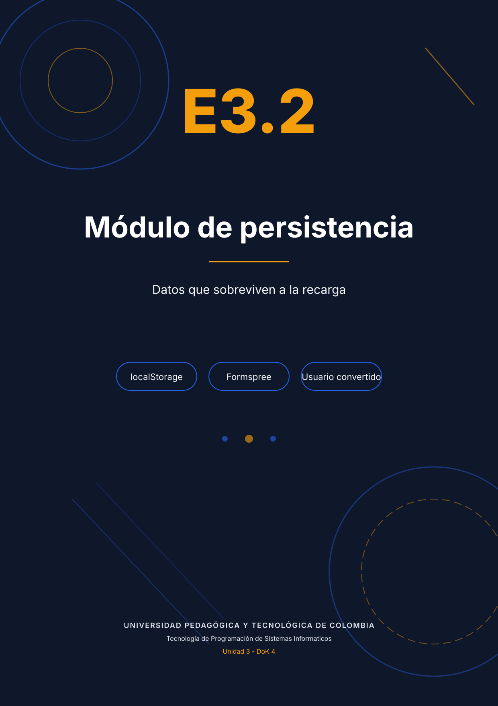
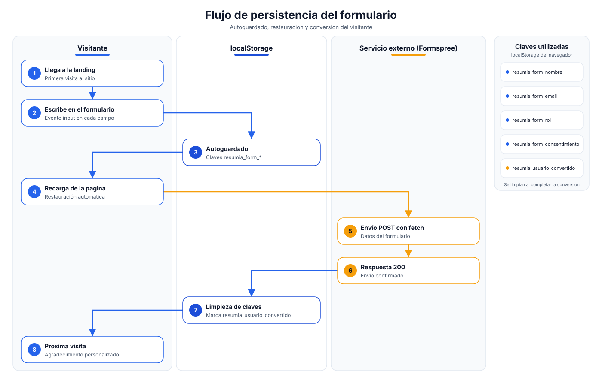
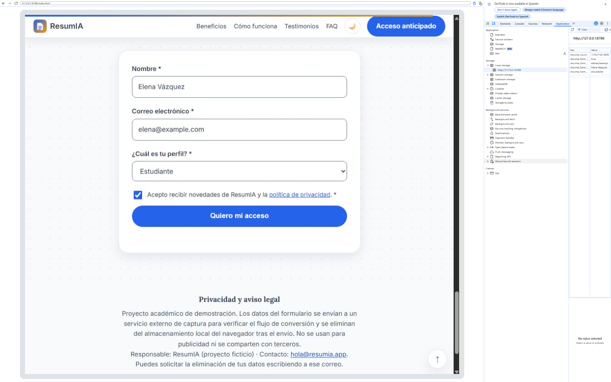
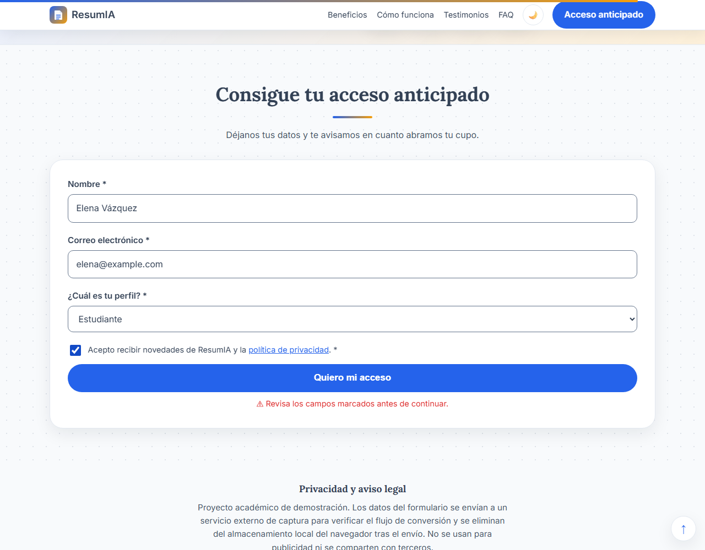
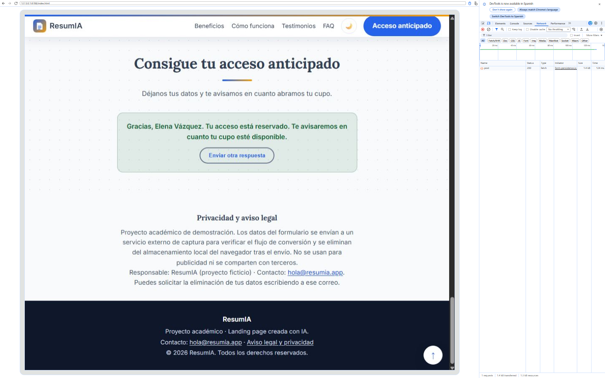
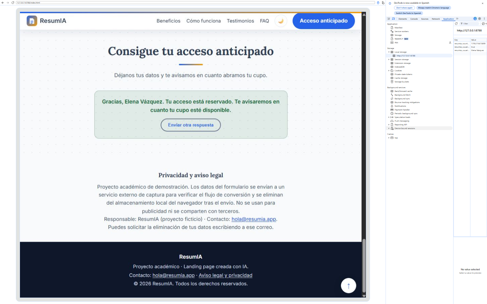

<div class="portada"></div>

# E3.2 — Módulo de persistencia integrado al Proyecto Final

**Producto:** ResumIA — landing de captura para la beta.
**Implementación:** `assets/js/form-persistence.js`, `assets/js/countdown.js`, `assets/js/core.js`.
**Demostración:** `demo_persistencia.mp4` (2 min 18 s).
**Nivel:** DoK 4 — Pensamiento extendido.

## 1. Documento de diseño de persistencia

### 1.1 Requerimientos identificados

La landing tiene un objetivo único: convertir una visita en un correo registrado. La persistencia no se agregó "porque se podía", sino para resolver seis necesidades concretas del producto.

| N.º | Dato a persistir | Mecanismo | Justificación técnica | Clave |
|---|---|---|---|---|
| R1 | Nombre del visitante | localStorage | El visitante suele abandonar y volver; el nombre evita reescribir y mantiene la experiencia personal. No es sensible y no debe viajar al servidor hasta el envío. | `resumia_form_nombre` |
| R2 | Correo electrónico | localStorage | Es el dato de conversión. Perderlo por una recarga es perder el lead. Persistir en el navegador permite recuperarlo sin crear una cuenta. | `resumia_form_email` |
| R3 | Perfil (estudiante, docente, investigador, etc.) | localStorage | Segmenta la beta y permite personalizar la comunicación. El valor es una categoría, no un dato identificable. | `resumia_form_rol` |
| R4 | Consentimiento | localStorage | Debe reflejar la decisión del usuario entre recargas. Se guarda como `"true"`/`"false"` para no confundir "no aceptó" con "nunca se le preguntó". | `resumia_form_consentimiento` |
| R5 | Estado de conversión | localStorage | Si ya envió el formulario, no debe volver a verlo. Incluye el nombre para personalizar el agradecimiento. | `resumia_usuario_convertido`, `resumia_usuario_nombre` |
| R6 | Fecha de cierre de la cohorte | localStorage | El contador no debe reiniciarse en cada visita; la fecha se fija una vez y se conserva. | `resumia_countdown_fin` |

Se descartaron `sessionStorage` (se pierde al cerrar la pestaña, justo el escenario que se quiere cubrir) y las cookies (se envían automáticamente en cada petición y añaden ruido de privacidad). localStorage es síncrono, tiene una cuota suficiente (≈5 MB) y no se transmite por la red, lo que reduce la exposición de datos personales.



### 1.2 Flujo de datos de una visita típica

1. El visitante llega a la landing. El módulo de persistencia comprueba si existe `resumia_usuario_convertido`.
2. Si no existe, restaura el borrador: lee cada clave `resumia_form_*` y rellena los campos. Si había datos, muestra el aviso "Recuperamos el borrador…".
3. Mientras escribe, el evento `input` guarda el valor del campo; `change` cubre el `select` y el `checkbox`.
4. Si recarga, el paso 2 devuelve los valores y el usuario continúa donde estaba.
5. Al enviar, se valida, se compone un JSON y se hace `POST` con `fetch` al endpoint configurado en `data-endpoint`.
6. Si la respuesta es `ok`, se guarda la marca de conversión, se eliminan las cuatro claves del borrador y se muestra el agradecimiento personalizado.
7. En la siguiente visita, la marca de conversión evita el formulario y muestra directamente el mensaje de usuario ya registrado.

### 1.3 Decisión sobre el servicio externo de envío

| Servicio | Ventajas | Limitaciones para este proyecto | Decisión |
|---|---|---|---|
| **Formspree** | Endpoint JSON sin backend, funciona en GitHub Pages, panel de envíos, honeypot y límite gratuito suficiente para una beta académica. | Requiere crear una cuenta y verificar el correo; el plan gratuito limita el número de envíos mensuales. | **Elegido para producción.** El formulario ya envía JSON y acepta `_subject`; solo hay que sustituir el endpoint por `https://formspree.io/f/TU_ID`. |
| Netlify Forms | Integración nativa si el sitio se aloja en Netlify. | El proyecto vive en GitHub Pages; obligaría a cambiar de hosting o a duplicar el despliegue. | Descartado. |
| EmailJS | Envía correos desde el cliente con una plantilla. | Expone una clave pública y depende de un SDK externo; más superficie y más peso para una sola petición. | Descartado. |

Para la demostración académica se usa `https://httpbin.org/post`, un servicio HTTP real que devuelve el cuerpo recibido. Esto permite verificar el `POST`, el estado 200 y el JSON enviado sin depender de una cuenta. La evidencia de recepción es la respuesta de la API capturada en DevTools; en producción, esa misma respuesta la emite Formspree y además genera el correo.

## 2. Código implementado y verificado

El módulo está en `assets/js/form-persistence.js` y cumple el protocolo del sistema: IIFE, modo estricto, script al final del `body`, sin variables globales.

```js
const CLAVES = {
  nombre: "resumia_form_nombre",
  email: "resumia_form_email",
  rol: "resumia_form_rol",
  consentimiento: "resumia_form_consentimiento"
};
const CLAVE_CONVERTIDO = "resumia_usuario_convertido";
const ENDPOINT = formulario.dataset.endpoint;
```

Autoguardado: se registra una sola vez por campo, dentro de una función de inicialización. El honeypot `_gotcha` se excluye explícitamente.

```js
campos.forEach((campo) => {
  if (!claveDe(campo)) return;
  campo.addEventListener("input", () => guardarCampo(campo));
  campo.addEventListener("change", () => guardarCampo(campo));
});
window.addEventListener("pagehide", guardarBorradorCompleto);
```

Envío con `fetch`, `AbortController` y comprobación de estado:

```js
const respuesta = await fetch(ENDPOINT, {
  method: "POST",
  headers: { "Content-Type": "application/json", "Accept": "application/json" },
  body: JSON.stringify(payload),
  signal: control.signal
});
if (!respuesta.ok) throw new Error("HTTP " + respuesta.status);
```

Limpieza y estado de conversión:

```js
guardar(CLAVE_CONVERTIDO, "true");
guardar(CLAVE_NOMBRE, payload.nombre);
limpiarBorrador();          // elimina resumia_form_*
mostrarConvertido(payload.nombre);
```

Todo el almacenamiento pasa por `try/catch`: en modo privado el formulario sigue funcionando, solo se pierde la persistencia entre recargas. Los mensajes de error usan `textContent` y una región `aria-live`.

### Prompts usados (3)

```text
[P1 — generación inicial]
Genera el JavaScript de un formulario de captura que guarde cada campo en
localStorage mientras el usuario escribe, restaure los valores al cargar y
envíe a un endpoint externo con fetch. Usa claves con prefijo resumia_form_,
modo estricto e IIFE. Sin frameworks.

[P2 — corrección/ajuste]
El envío debe comprobar response.ok, usar AbortController y no perder el
borrador si falla la red. Añade un honeypot _gotcha y no registres datos
personales en consola. Mantén la validación accesible existente.

[P3 — usuario ya convertido]
Añade una marca resumia_usuario_convertido en localStorage. Si existe, oculta
el formulario y muestra un mensaje de agradecimiento con el nombre guardado.
Tras un envío exitoso, limpia las claves del borrador y conserva solo la marca
y el nombre.
```

## 3. Verificación en DevTools

**Autoguardado.** El panel Application muestra las claves `resumia_form_*` mientras el formulario tiene datos. La captura se tomó con el formulario diligenciado y la tabla de almacenamiento abierta.



**Restauración.** Tras recargar, los cuatro campos vuelven con sus valores y aparece el aviso de borrador recuperado. La prueba automatizada devolvió:

```json
{"nombre":"Elena Vázquez","email":"elena@example.com","rol":"estudiante","consentimiento":true,"aviso":true}
```



**Envío externo.** La pestaña Network registra un `POST` con estado 200; la respuesta contiene exactamente el JSON enviado:

```json
{"_subject":"Nuevo acceso anticipado a ResumIA","consentimiento":true,
 "email":"elena@example.com","nombre":"Elena Vázquez","origen":"landing-resumia",
 "rol":"estudiante"}
```



**Limpieza y usuario convertido.** Después del envío, el formulario desaparece y el almacenamiento conserva únicamente `resumia_usuario_convertido`, `resumia_usuario_nombre` (y la fecha del contador). Las claves `resumia_form_*` ya no existen. Al recargar, el mensaje personalizado se mantiene.



La prueba automatizada confirmó el estado:

```json
{"borradorRestante":[],"convertido":"true","formOculto":true,
 "texto":"Gracias, Elena Vázquez. Tu acceso está reservado. Te avisaremos en cuanto tu cupo esté disponible."}
```

## 4. Video de demostración

El archivo `demo_persistencia.mp4` dura 2 min 18 s e incluye subtítulos en español. Recorre: (1) la landing y el formulario; (2) el autoguardado campo por campo con el panel Application visible; (3) la recarga con restauración; (4) el envío real y la respuesta del servicio; (5) la limpieza del borrador; (6) la visita posterior con el mensaje de usuario convertido. El guion y las marcas de tiempo están en `guion_video.md`.

## 5. Conclusión

La persistencia resolvió un problema real del producto y no un requisito aislado: el formulario ahora sobrevive a la recarga, evita perder leads y recuerda la conversión. La decisión técnica central —localStorage con namespace y un servicio externo sin backend— es coherente con un sitio estático publicado en GitHub Pages y deja una ruta clara de migración a Formspree para producción.
