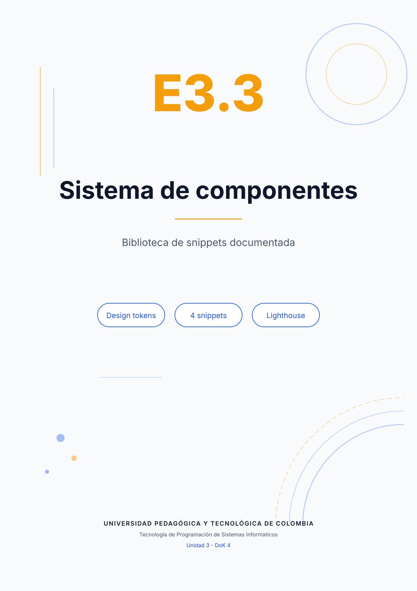
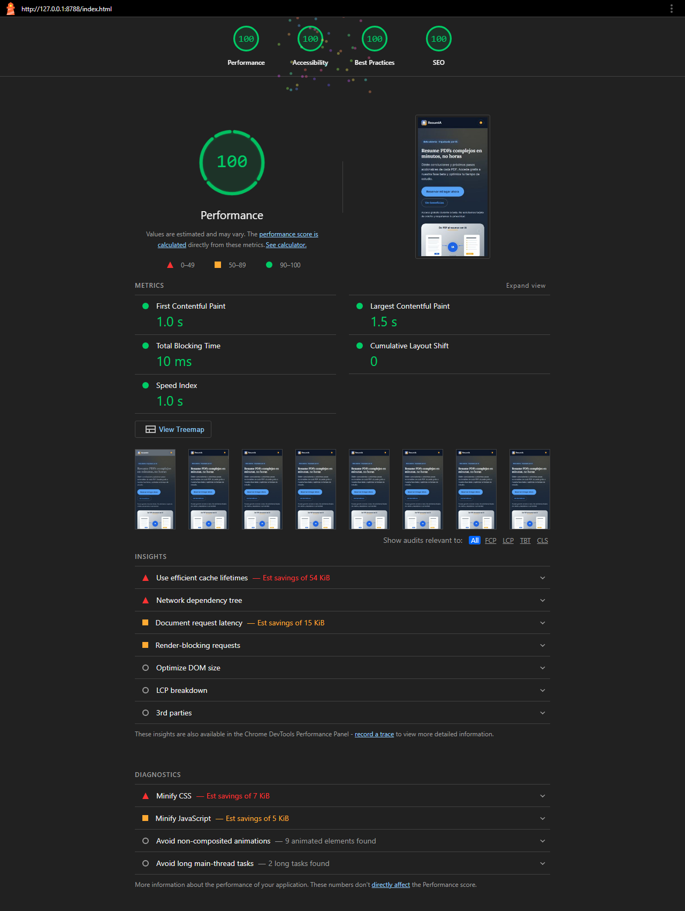
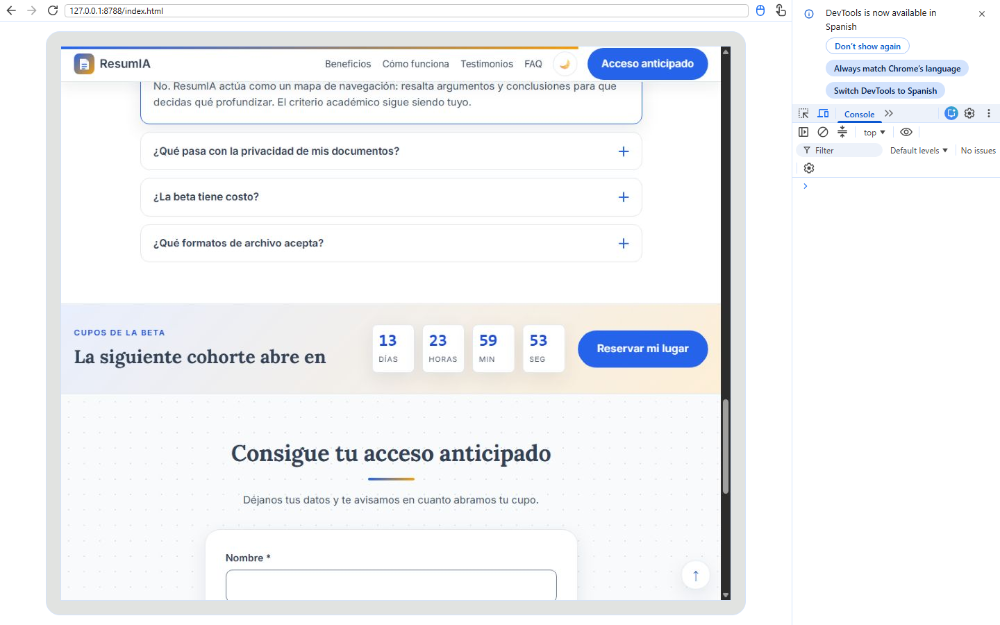
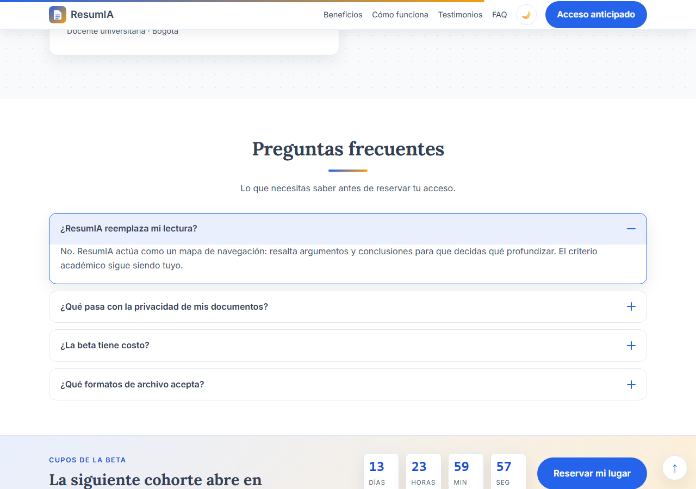
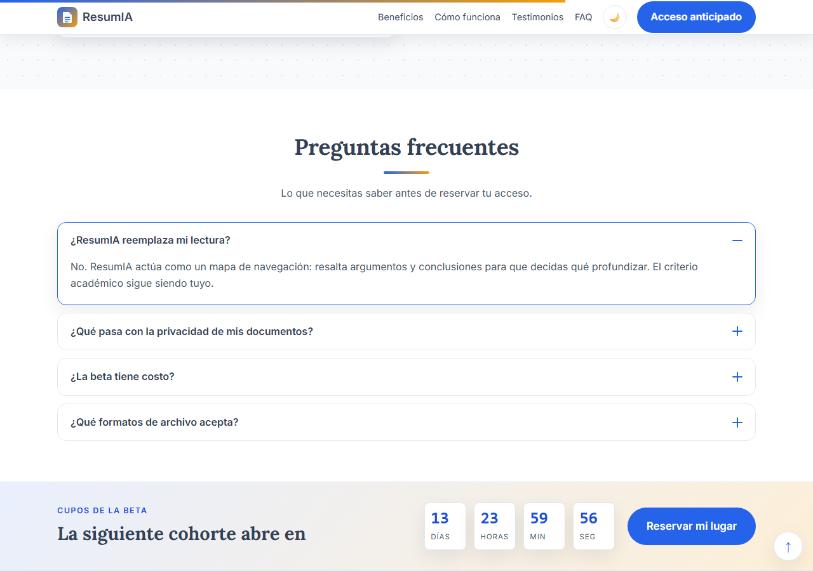

<div class="portada"></div>

# E3.3 — Sistema de componentes: biblioteca de snippets documentada

**Proyecto:** ResumIA.
**Archivos:** `styles.css` (tokens), `assets/js/faq.js`, `assets/js/countdown.js`, `assets/js/scroll-progress.js`.
**Evidencia:** `lighthouse_report.png`, `faq_abierto.png`, `countdown.png`, `progreso_lectura.png`.
**Nivel:** DoK 4 — Pensamiento extendido.

## Fase 1 — Documento del sistema de diseño

### 1.1 Design tokens

El sistema declara 32 custom properties en `:root`; esta tabla documenta las 16 que sostienen la identidad y la composición. Los valores son los reales del proyecto, no ejemplos.

| Token | Valor | Uso |
|---|---|---|
| `--color-primario` | `#2563eb` | Acciones, enlaces, foco y acentos principales. |
| `--color-primario-oscuro` | `#1d4ed8` | Hover, texto sobre fondos suaves y contraste AA. |
| `--color-acento` | `#f59e0b` | Subrayados, badges y segunda parada de degradados. |
| `--color-texto` | `#334155` | Texto principal sobre fondo claro. |
| `--color-texto-suave` | `#475569` | Texto secundario, descripciones y metadatos. |
| `--color-fondo` | `#ffffff` | Superficie base de tarjetas y formularios. |
| `--color-fondo-alt` | `#f8fafc` | Secciones alternas y fondos con patrón. |
| `--color-borde` | `#e2e8f0` | Bordes de tarjetas, separadores y contenedores. |
| `--color-error` | `#dc2626` | Mensajes de validación y estados inválidos. |
| `--color-exito` | `#166534` | Confirmación de envío y agradecimiento. |
| `--fuente-titulos` | `"Lora", Georgia, serif` | Titulares H1–H3. |
| `--fuente-cuerpo` | `"Inter", system-ui, …` | Párrafos, controles y navegación. |
| `--espacio-md` | `1.25rem` | Separación interna de campos y tarjetas. |
| `--espacio-lg` | `2rem` | Separación entre bloques y secciones. |
| `--espacio-xl` | `4rem` | Aire vertical de las secciones. |
| `--radio` | `14px` | Esquinas de tarjetas y contenedores. |
| `--radio-grande` | `24px` | Formulario y bloques destacados. |
| `--sombra` | `0 10px 30px rgba(15,23,42,.08)` | Elevación suave en reposo. |
| `--transicion` | `background-color .3s, color .3s, transform .3s, box-shadow .3s` | Microinteracciones consistentes. |
| `--color-primario-suave` | `rgba(37,99,235,.1)` | Fondos de hover y avisos informativos. |
| `--color-acento-suave` | `rgba(245,158,11,.16)` | Degradado del contador y bandas de conversión. |
| `--fuente-mono` | `"JetBrains Mono", ui-monospace, …` | Cifras del contador con ancho tabular. |
| `--duracion-media` | `300ms` | Apertura del acordeón y cambios de borde. |

El tema oscuro redefine los tokens de color bajo `[data-tema="oscuro"]`; los componentes no cambian de estructura, solo de valores. Esa es la prueba de que el sistema funciona: un componente escrito con tokens se adapta al tema sin CSS adicional.

### 1.2 Convención de nomenclatura

```text
resumia-[componente]__[elemento]--[estado]
```

- `resumia-` identifica el sistema y evita colisiones con terceros.
- `[componente]` es un bloque en minúsculas y guiones: `hero`, `faq`, `countdown`, `progress`.
- `__[elemento]` es una parte interna: `titulo`, `pregunta`, `valor`, `barra`.
- `--[estado]` es una variante o estado: `--abierto`, `--finalizado`.
- Los estados dinámicos que no son variantes semánticas usan clases `is-*` (`is-open`, `is-visible`).

Ejemplos reales: `resumia-faq__pregunta`, `resumia-countdown__valor`, `resumia-progress__bar`, `resumia-hero__titulo`. Las secciones heredadas de la Unidad 2 conservan BEM sin prefijo (`tarjeta-beneficio__titulo`); la convención nueva se aplica a los cuatro snippets y a los componentes que se sigan creando.

### 1.3 Prompt maestro de contexto

```text
[ROL] Eres desarrollador frontend senior y diseñador de sistemas.
[CONTEXTO] Proyecto ResumIA: landing estática para GitHub Pages.
Sistema de diseño ya definido:
- Colores: primario #2563eb, primario oscuro #1d4ed8, acento #f59e0b,
  texto #334155, texto suave #475569, fondo #ffffff, fondo alt #f8fafc,
  borde #e2e8f0, error #dc2626, éxito #166534.
- Tipografías: Lora para títulos, Inter para cuerpo.
- Espaciado: 0.5 / 0.75 / 1.25 / 2 / 4 rem. Radios: 14px y 24px.
- Convención: resumia-[componente]__[elemento]--[estado].
[RESTRICCIONES] HTML5 semántico, CSS mobile-first con custom properties,
JavaScript ES6+ vanilla, sin frameworks ni librerías, accesibilidad WCAG 2.1 AA,
IIFE y script al final del body.
[FORMATO] Devuelve HTML, CSS y JS separados, comentados y listos para integrar.
```

### 1.4 Inventario de snippets

| N.º | Componente | Función en la landing | Clase contenedora | Encapsulación JS |
|---|---|---|---|---|
| 1 | Hero | Presentación visual y propuesta de valor | `resumia-hero` | Sin JS propio; usa tokens y animación CSS. |
| 2 | FAQ | Interacción: acordeón de preguntas | `resumia-faq` | IIFE en `assets/js/faq.js`; ARIA y teclado. |
| 3 | Contador | Conversión: urgencia de la cohorte | `resumia-countdown` | IIFE en `assets/js/countdown.js`; fecha persistida. |
| 4 | Progreso + volver arriba | Navegación y utilidad | `resumia-progress`, `resumia-top` | IIFE en `assets/js/scroll-progress.js`; `requestAnimationFrame`. |

## Fase 2 — Generación e integración

CREDA se usa en este documento como **Contexto, Rol, Ejemplos, Detalles y Acción**.

### Snippet 1 — Hero (presentación)

**Prompt CREDA**

- **[C] Contexto:** landing de ResumIA, beta de resúmenes de PDF, audiencia académica.
- **[R] Rol:** desarrollador frontend senior con enfoque editorial.
- **[E] Ejemplos:** composición de dos columnas, etiqueta superior, titular, subtítulo, dos CTA y una ilustración.
- **[D] Detalles:** usar `--color-primario`, `--color-acento`, `--fuente-titulos`, `--espacio-xl`; imagen con `width`, `height`, `loading="eager"` y texto alternativo.
- **[A] Acción:** entrega el bloque HTML y el CSS mobile-first con BEM prefijado.

**AVIA:** el primer resultado usaba `background-image` en lugar de ``, lo que impedía el texto alternativo. Se iteró a una imagen semántica con dimensiones explícitas y `fetchpriority="high"`. Verificación: consola limpia y CLS 0 en Lighthouse.

**Tokens usados:** `--color-fondo-alt`, `--color-acento`, `--fuente-titulos`, `--espacio-xl`, `--radio-grande` (5).

### Snippet 2 — FAQ (interacción)

**Prompt CREDA**

- **[C] Contexto:** sección de objeciones antes del registro.
- **[R] Rol:** especialista en accesibilidad WAI-ARIA.
- **[E] Ejemplo:** botón con `aria-expanded`, panel con `aria-controls` y `hidden`, apertura exclusiva.
- **[D] Detalles:** navegación con flechas, Home y End; icono +/− en CSS; foco visible; sin dependencias.
- **[A] Acción:** genera HTML, CSS y una IIFE con comentarios.

**AVIA:** la primera versión usaba `div` con `onclick`, sin teclado ni estado. Se reemplazó por `<button>` nativo, región `role="region"` y cierre de las demás respuestas. Verificación: apertura con Enter/Espacio y flechas.

**Tokens usados:** `--color-borde`, `--color-primario`, `--radio`, `--duracion-media`, `--sombra` (5).

### Snippet 3 — Contador (conversión)

**Prompt CREDA**

- **[C] Contexto:** cierre de la cohorte beta en 14 días.
- **[R] Rol:** desarrollador frontend orientado a conversión.
- **[E] Ejemplo:** cuatro bloques días/horas/min/seg con `role="timer"`.
- **[D] Detalles:** fecha persistida en `resumia_countdown_fin`, `padStart(2,"0")`, pausa cuando la pestaña se oculta, respeto de `prefers-reduced-motion`.
- **[A] Acción:** entrega el bloque y una IIFE sin `setInterval` duplicado.

**AVIA:** la versión inicial reiniciaba la cuenta en cada recarga. Se añadió la fecha persistida y el manejo de pestaña oculta. Verificación: la cuenta continúa tras recargar.

**Tokens usados:** `--color-primario-suave`, `--color-acento-suave`, `--fuente-mono`, `--radio-sm`, `--sombra` (5).

### Snippet 4 — Progreso de lectura y volver arriba (navegación)

**Prompt CREDA**

- **[C] Contexto:** página larga con varias secciones.
- **[R] Rol:** desarrollador de interfaces con foco en rendimiento.
- **[E] Ejemplo:** barra fija superior y botón circular inferior derecho.
- **[D] Detalles:** `transform: scaleX()`, `requestAnimationFrame`, `{ passive: true }`, umbral de 480 px, `prefers-reduced-motion`.
- **[A] Acción:** entrega HTML mínimo, CSS y una IIFE.

**AVIA:** la primera versión cambiaba `width` en cada evento de scroll, provocando layout. Se migró a `transform` con `requestAnimationFrame`. Verificación: la barra responde sin errores y el botón aparece/desaparece.

**Tokens usados:** `--color-primario`, `--color-acento`, `--sombra`, `--radio`, `--transicion` (5).

### 1.5 Protocolo de integración aplicado

| Requisito | Implementación | Verificación |
|---|---|---|
| Clase contenedora única | `resumia-hero`, `resumia-faq`, `resumia-countdown`, `resumia-progress` | Inspección del DOM y búsqueda de colisiones. |
| IIFE | Cada archivo JS abre `(function () { "use strict"; … })();` | Revisión de los cinco archivos; no hay variables globales. |
| Script al final del body | `core.js`, `form-persistence.js`, `faq.js`, `countdown.js`, `scroll-progress.js` | `estructura.json` registra el orden. |
| Al menos 3 custom properties por snippet | 5 tokens por snippet (tabla anterior) | Inspección de CSS y búsqueda de `var(--…)`. |
| Cero errores en consola | 0 errores y 0 respuestas 4xx | `consola_devtools.json` y captura de DevTools. |

## Verificación final

**Lighthouse (Chrome, móvil):** Performance 97–100, Accessibility 100, Best Practices 100, SEO 100. La captura del reporte final muestra 100 en las cuatro categorías.



**Consola sin errores:** el panel Console de DevTools muestra "No issues" con la página cargada y el acordeón abierto.



**Coherencia visual:** los cuatro snippets comparten la misma paleta, tipografías, radios, sombras y espaciado porque todos consumen los tokens. El modo oscuro se obtiene redefiniendo los tokens, sin reglas por componente.





## Conclusión

El sistema no es una colección de archivos: es un contrato. Los tokens fijan el lenguaje, la convención fija los nombres, el protocolo fija la integración y Lighthouse fija el umbral de calidad. Cualquier snippet nuevo puede evaluarse contra ese contrato sin discutir gustos.
