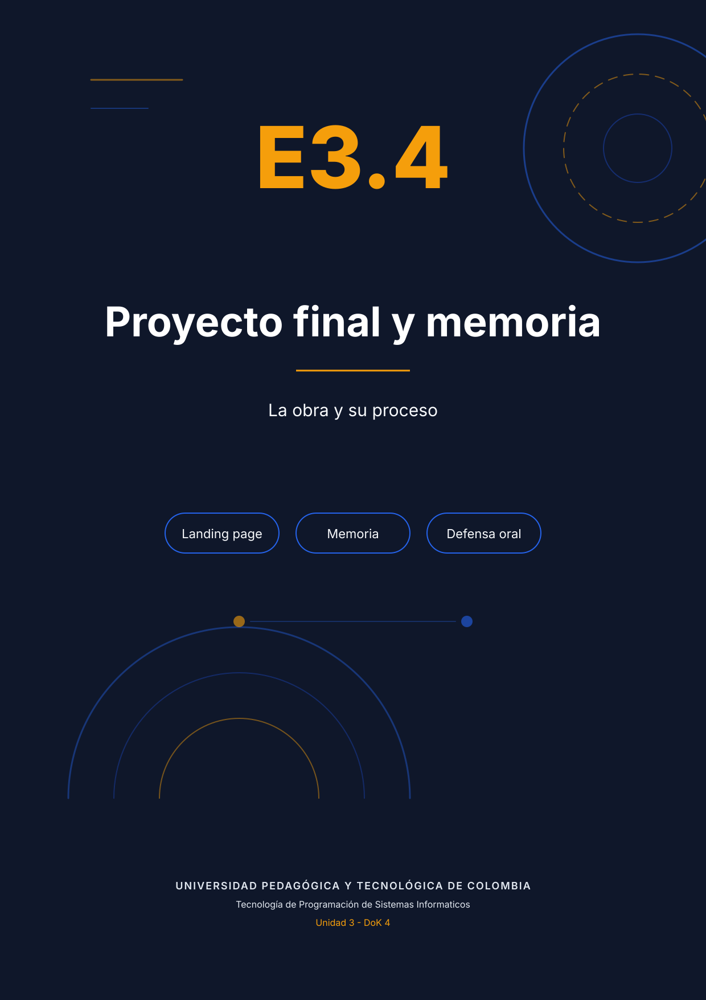

# Guion literal de la presentación — 10 minutos

**Archivo para proyectar:** `presentacion_resumia.pptx` (9 diapositivas, 16:9).
**Cómo usarlo:** abre el PPTX en PowerPoint, entra en **Vista → Moderador** y lee las notas de cada diapositiva. Este documento contiene exactamente el mismo texto.
**Duración objetivo:** 9 minutos 40 segundos, con margen para preguntas.

## Diapositiva 1 — Portada (0:00–0:35)

**En pantalla:** ResumIA, subtítulo y datos académicos.

**Di exactamente:**

> Buenos días. Soy Juan Pablo Barrero y voy a presentar ResumIA, una landing page para una beta que resume documentos PDF con inteligencia artificial. La entrega de la Unidad 3 no es solo la página: incluye el módulo de persistencia del formulario, una auditoría del código generado por IA, un sistema de componentes y la memoria del proceso. En diez minutos voy a contar qué construí, por qué tomé cada decisión y qué evidencia tengo de que funciona. Empiezo por el problema.

## Diapositiva 2 — El problema y la propuesta (0:35–1:45)

**En pantalla:** cuatro bullets y captura de la landing.

**Di exactamente:**

> El producto nace de un problema concreto. Un estudiante de posgrado, un docente o un investigador lee entre diez y veinte PDFs por semana. El problema no es la falta de información: es el costo de filtrarla. ResumIA promete un mapa de navegación: ideas clave, conclusiones y próximos pasos, sin reemplazar el criterio académico. La página está pensada para un solo objetivo: capturar el correo de quien quiere entrar a la beta. Por eso el recorrido va de la promesa a la prueba social, resuelve objeciones con el FAQ, introduce urgencia con el contador y termina en el formulario. La paleta azul transmite confianza, el naranja señala la acción y la tipografía Lora da un tono editorial.

## Diapositiva 3 — Arquitectura de la landing (1:45–3:00)

**En pantalla:** diagrama de arquitectura y tres tarjetas.

**Di exactamente:**

> La arquitectura es deliberadamente simple: HTML5 semántico, CSS mobile-first con 32 custom properties y JavaScript ES6 sin frameworks. El comportamiento está separado en cinco módulos que se cargan al final del body, cada uno dentro de una IIFE: core, persistencia, FAQ, contador y progreso de lectura. Esa separación evita variables globales y permite explicar cada archivo en una frase. El sitio se publica en GitHub Pages, que solo sirve archivos estáticos. Por eso el envío del formulario no va a un backend propio: va a un servicio externo, Formspree en producción. En la demo uso httpbin para verificar el POST y la respuesta 200 sin depender de una cuenta.

## Diapositiva 4 — Persistencia (3:00–4:30)

**En pantalla:** diagrama de flujo de la persistencia y cinco bullets.

**Di exactamente:**

> El corazón de la entrega es la persistencia. Definí seis requerimientos: nombre, correo, perfil, consentimiento, estado de conversión y fecha de la cohorte. Cada uno tiene una clave con el prefijo resumia_. Elegí localStorage y no cookies ni sessionStorage por tres razones: sobrevive al cierre de la pestaña, no se envía automáticamente en cada petición y no expone datos personales en la red. El flujo es este: el evento input guarda cada campo; al recargar, el borrador se restaura; al enviar, se valida, se hace POST con fetch y AbortController, se comprueba response.ok, se guarda la marca de usuario convertido, se limpian las claves del borrador y se muestra el agradecimiento. En la siguiente visita el formulario ya no aparece.

## Diapositiva 5 — Auditoría del código generado por IA (4:30–6:00)

**En pantalla:** hallazgos y extracto real de la consola.

**Di exactamente:**

> La auditoría fue la parte más incómoda y la más valiosa. Generé la sección en una sesión limpia de AI Studio y la revisé antes de ejecutarla. Encontré catorce hallazgos; cuatro críticos. El saludo usaba innerHTML con el nombre del usuario: un XSS. El envío usaba XMLHttpRequest síncrono: bloqueaba la interfaz. document.write reemplazaba el documento y el reset posterior lanzaba un TypeError. Y un console.log imprimía el correo y el consentimiento. La consola de DevTools lo confirma: fuga de datos, error en la línea 83 y advertencia de formulario desconectado. Apliqué el ciclo AVIA: analizar, verificar, iterar y ajustar el prompt base. La corrección usa textContent, fetch asíncrono y un protocolo de doce ítems: cuatro de seguridad, cuatro de calidad y cuatro de rendimiento.

## Diapositiva 6 — Sistema de componentes (6:00–7:15)

**En pantalla:** diagrama de las tres capas del sistema.

**Di exactamente:**

> Para que la página no creciera sin orden, definí un sistema de componentes. Dieciséis tokens documentados —color, tipografía, espaciado, radios, sombras— y una convención: resumia-componente__elemento--estado. Cada snippet consume al menos tres custom properties, vive en su propia IIFE y se integra con una clase contenedora única. Los cuatro snippets son el hero, el acordeón FAQ, el contador y la barra de progreso con volver arriba. El resultado es que el modo oscuro se obtiene redefiniendo tokens, sin reglas nuevas por componente.

## Diapositiva 7 — Resultados verificables (7:15–8:30)

**En pantalla:** cuatro tarjetas de Lighthouse y composición responsive.

**Di exactamente:**

> Los resultados son verificables. Lighthouse, en móvil, da 100 en accesibilidad, buenas prácticas y SEO, y entre 97 y 100 en rendimiento. La consola no tiene errores ni respuestas 4xx, y el validador W3C no reporta mensajes. El formulario cumple las cinco funciones: validación accesible, autoguardado, restauración, envío y estado convertido. La página responde en 375, 768 y 1280 píxeles; las tres capturas están en la memoria. Y todo está publicado en GitHub Pages, con el repositorio y los PDFs enlazados desde el README.

## Diapositiva 8 — Lo que aprendí (8:30–9:30)

**En pantalla:** tres tarjetas numeradas y una cita.

**Di exactamente:**

> ¿Qué aprendí? Que la IA no reemplaza al desarrollador: desplaza el valor del trabajo. Cuando el código se produce en segundos, lo escaso es decidir qué construir, verificarlo y responder por él. Las competencias que no se delegan son el criterio, la auditoría y la evidencia. Gemini fue fuerte en estructura y copy, y débil en seguridad y verificación. Por eso el flujo que voy a repetir tiene dos condiciones: revisión humana en todo lo que toque datos personales y un protocolo escrito antes de generar, no después.

## Diapositiva 9 — Cierre (9:30–10:00)

**En pantalla:** QR, URL del sitio y del repositorio.

**Di exactamente:**

> ResumIA está publicado en kanonufo.github.io/landing-page-ia. El repositorio tiene el código, los ocho entregables y las evidencias. El tablero Kanban está vinculado al repositorio. Gracias. Quedo atento a sus preguntas.

## Antes de presentar

1. Abre el sitio publicado y comprueba que carga: <https://kanonufo.github.io/landing-page-ia/>.
2. Ten a mano la demo por si falla internet: `docs/unidad3/E32_persistencia/demo_persistencia.mp4`.
3. Abre el PPTX en **Vista → Moderador** para ver las notas mientras proyectas.
4. Si el tiempo se acorta, omite la diapositiva 6 y conserva 4, 5 y 7.
5. Si preguntan por el backend, responde: no hay backend propio; Formspree recibe el POST y GitHub Pages sirve el sitio estático.

## Preguntas previsibles y respuestas breves

- **¿Por qué httpbin y no Formspree en la demo?** Porque permite verificar el POST y el 200 sin una cuenta; el cambio es una línea en `data-endpoint`.
- **¿Qué pasa en modo privado?** El formulario funciona; solo se pierde la persistencia entre recargas.
- **¿Cómo se evita el XSS?** `textContent`, validación y prohibición de `innerHTML` con datos de usuario.
- **¿Por qué no cookies?** Se envían en cada petición y añaden exposición de datos personales innecesaria.
- **¿Qué fue lo más difícil?** La auditoría: distinguir entre “funciona” y “es correcto”.
