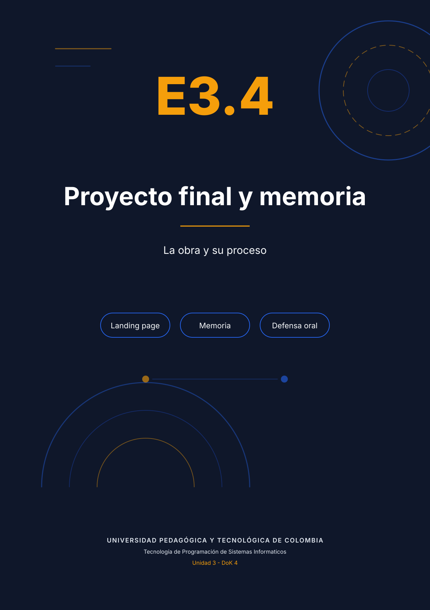
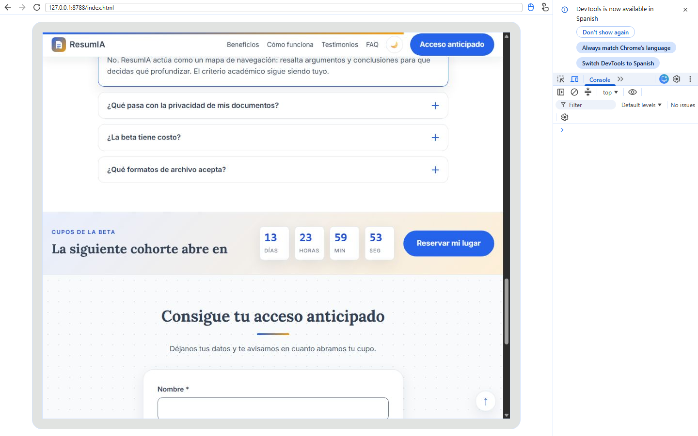
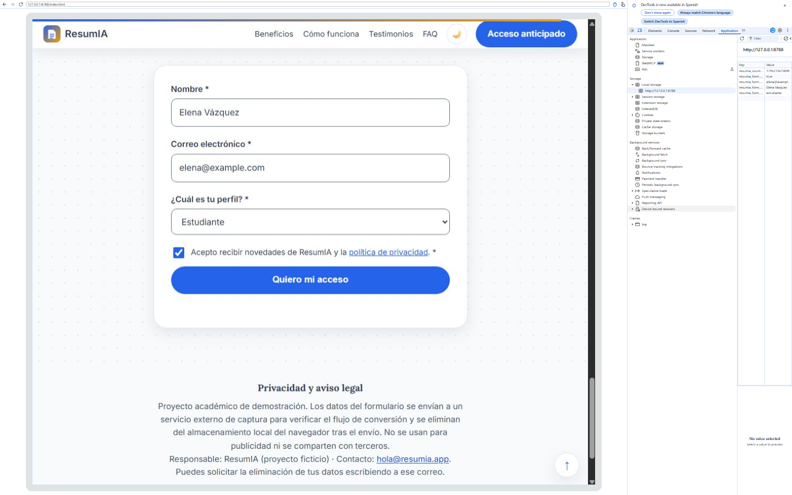
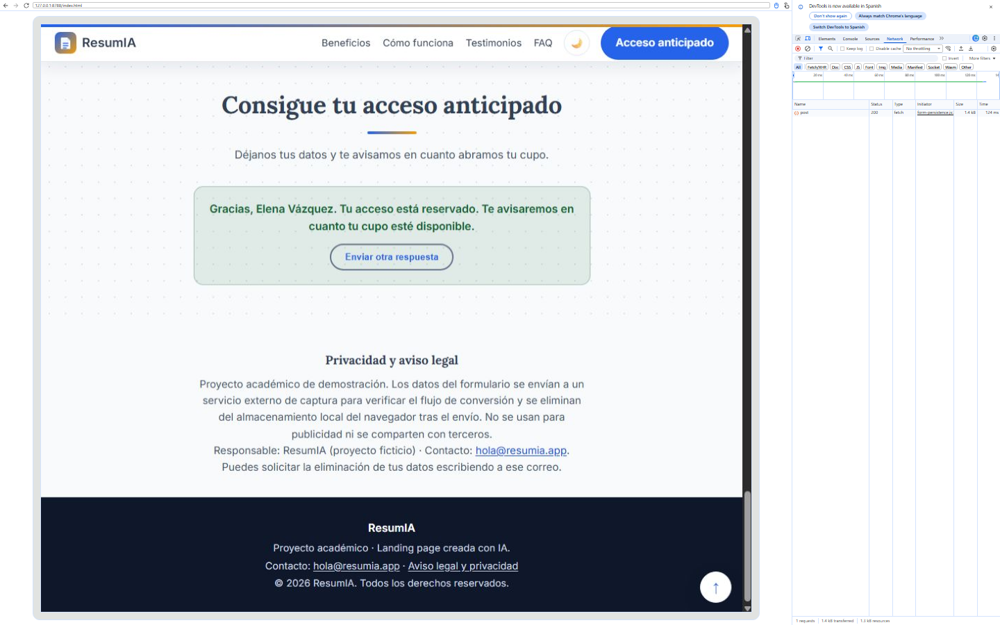
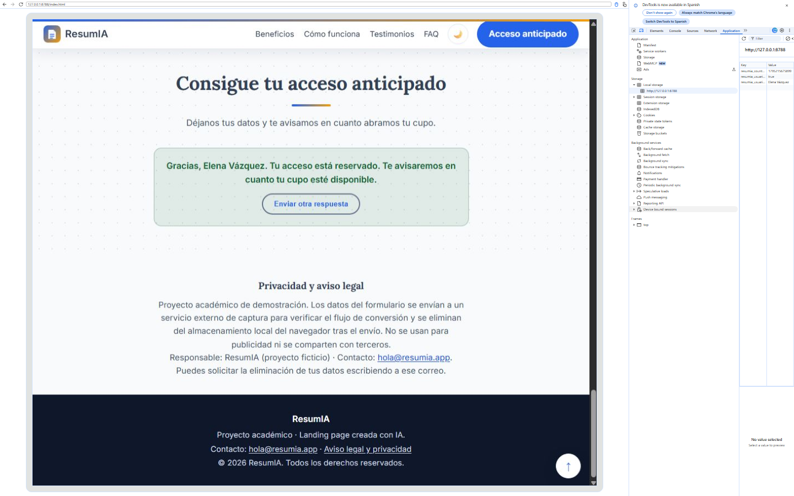
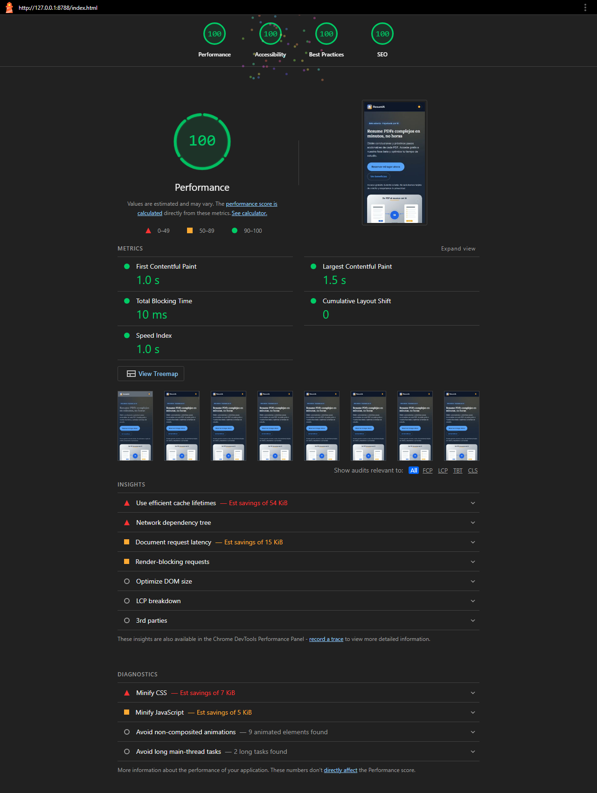
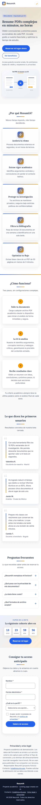
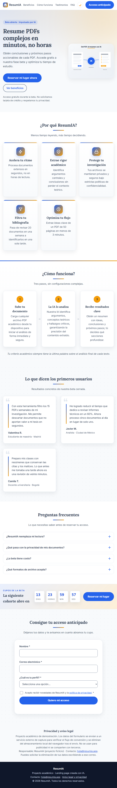
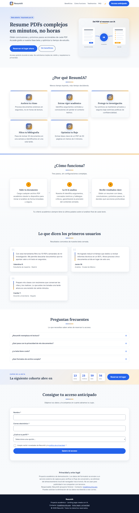

<div class="portada"></div>

# E3.4 — Proyecto Final: landing page completa y memoria reflexiva de proceso

**Producto:** ResumIA.
**Sitio:** <https://kanonufo.github.io/landing-page-ia/>
**Repositorio:** <https://github.com/kanonufo/landing-page-ia>
**Nivel:** DoK 4 — Pensamiento extendido.

## 1. El producto y su propuesta de valor

ResumIA es una beta ficticia que convierte documentos PDF extensos en resúmenes claros: ideas clave, conclusiones y próximos pasos. No se dirige a "todo el mundo", sino a un público concreto: estudiantes de posgrado, docentes e investigadores que leen entre diez y veinte documentos por semana y necesitan decidir cuáles merecen una lectura profunda. El problema no es la falta de información, sino el costo de filtrarla. La promesa del producto es recuperar tiempo sin renunciar al criterio académico.

Esa propuesta se tradujo en decisiones de diseño verificables. La paleta azul transmite confianza y rigor; el naranja introduce urgencia y calidez en los puntos de conversión sin competir con el texto. Lora, una serif editorial, da a los titulares un tono académico; Inter, una sans de interfaz, mantiene legible el cuerpo y los formularios. El copy evita promesas absolutas: "mapa de navegación", "tú decides qué profundizar", "tu criterio tiene la última palabra". La página no vende magia; vende una reducción medible del tiempo de filtrado.

La estructura sigue el recorrido de una objeción, no un catálogo de características. El hero presenta la promesa; los beneficios la cuantifican; "cómo funciona" responde al miedo a perder matices; los testimonios aportan prueba social; el FAQ desmonta las últimas dudas; el contador introduce una razón para actuar ahora; el formulario captura el correo; el aviso legal cierra la confianza. Cada sección tiene una función y un orden justificado.

## 2. El proceso de generación con IA

El proyecto se construyó con la metodología de cinco fases trabajada en la electiva: exploración, definición, generación, refinamiento y consolidación. En cada fase se documentó el prompt, la salida y la decisión.

### Prompt 1 — Exploración

```text
Actúa como estratega de producto. Define el buyer persona de una landing para
un asistente de IA que resume PDFs académicos: dolores, deseos, objeciones y
criterios de decisión. Devuelve una tabla y tres implicaciones para el copy.
```

Funcionó: obligó a nombrar el dolor real ("digerir montañas de PDFs") y la objeción central ("la IA simplifica demasiado"). Requirió iteración para eliminar generalidades y aterrizar el lenguaje en el contexto universitario.

### Prompt 2 — Definición

```text
Con el buyer persona anterior, propón la estructura de secciones y el copy del
hero. Una sola idea por sección, tono académico y claro, sin superlativos.
Incluye un titular de máximo 9 palabras y un subtítulo de máximo 35.
```

El primer resultado fue genérico ("La mejor IA para tus documentos"). El segundo, con la restricción de longitud y la objeción incorporada, produjo "Resume PDFs complejos en minutos, no horas". Ese es el caso antes/después más claro del proyecto: la restricción no limitó la creatividad, la enfocó.

### Prompt 3 — Generación

```text
Genera el HTML semántico de la landing con las secciones acordadas. Usa BEM,
atributos ARIA donde aporten significado, imágenes con dimensiones y un
formulario accesible. Sin frameworks.
```

La salida fue una base correcta, pero con `div` donde hacía falta `section`, imágenes sin `width/height` y errores de anidación. Se corrigió con prompts de refinamiento y revisión manual.

### Prompt 4 — Refinamiento

```text
Revisa el HTML contra WCAG 2.1 AA: contraste, foco visible, etiquetas,
jerarquía de encabezados y regiones de error. Devuelve solo los cambios
necesarios, con la razón técnica de cada uno.
```

Aquí apareció una de las lecciones del proyecto: la IA detecta bien los patrones conocidos (foco, etiquetas) y falla en lo contextual (contraste real de un enlace sobre un fondo concreto). La corrección final del contraste del enlace legal se hizo midiendo, no confiando.

### Prompt 5 — Consolidación

```text
Documenta el proyecto para otra persona: README con propósito, stack, cómo
ejecutar, cómo personalizar y créditos. Añade el diario de prompts y las
decisiones técnicas con su alternativa descartada.
```

Esta fase fue la más difícil. No por la redacción, sino porque exige honestidad: documentar lo que se descartó, lo que falló y lo que se corrigió. Un README que solo enumera tecnologías no sirve; uno que explica por qué se eligió localStorage y no cookies sí.

### La fase más difícil

La fase de refinamiento fue la más difícil porque obliga a distinguir entre "funciona" y "es correcto". Un formulario puede verse bien y perder datos; un contador puede funcionar y reiniciarse; un enlace puede ser legible para quien lo escribió y tener 1.55:1 de contraste para el resto. Esa fase es la que convierte a la IA en asistente y no en autoridad.

## 3. Decisiones técnicas justificadas

| Decisión | Alternativa considerada | Decisión tomada | Justificación |
|---|---|---|---|
| Persistencia del formulario | Cookies o sessionStorage | localStorage con namespace `resumia_` | Sobrevive al cierre de pestaña, no se envía en cada petición y evita exponer datos personales en la red. |
| Servicio de captura | Netlify Forms o EmailJS | Formspree (demo con httpbin) | Funciona en GitHub Pages sin backend, acepta JSON y no exige cambiar el hosting. |
| Arquitectura JS | Un único `script.js` | Cinco módulos IIFE | Aísla responsabilidades, permite cargar al final del body y evita colisiones globales. |
| Animaciones de aparición | Mostrar todo siempre o animar con JS pesado | IntersectionObserver + CSS | Bajo costo, respeta `prefers-reduced-motion` y no bloquea el render. |
| Tipografías | Autoalojar o `@import` | Google Fonts con `preload` y carga no bloqueante | Mantiene la identidad Lora/Inter sin bloquear el primer pintado; el fallback del sistema evita CLS. |
| Contador de cohorte | Reiniciar en cada visita | Fecha persistida en localStorage | La urgencia debe ser creíble; una cuenta que se reinicia destruye la confianza. |

## 4. Evidencias del proceso

**Consola sin errores.** La landing cargada, con el acordeón abierto y la consola en "No issues".



**Persistencia durante la interacción.** El panel Application muestra las claves `resumia_form_*` mientras el formulario tiene datos.



**Recepción del servicio externo.** El `POST` devuelve 200 y el cuerpo con los datos enviados.



**Estado de usuario convertido.** Después del envío, el formulario se oculta y el almacenamiento conserva solo la marca de conversión y el nombre.



**Lighthouse.** Performance 97–100, Accessibility 100, Best Practices 100, SEO 100.



**Responsive.** Vistas a 375 px, 768 px y 1280 px.







**Verificación de especificaciones técnicas**

| Especificación | Estado | Evidencia |
|---|---|---|
| 6+ secciones (hero, valor, características, testimonios, formulario, footer/legal) | Cumple: 8 secciones + hero | `estructura.json`: beneficios, como-funciona, testimonios, faq, acceso, registro, privacidad. |
| HTML5 semántico (`nav`, `main`, `section`, `article`, `footer`) | Cumple | `index.html` y validación W3C de la Unidad 2. |
| 8+ custom properties en `:root` | Cumple: 32 | `styles.css` y `estructura.json`. |
| 3+ snippets ES6+ con IIFE y namespacing | Cumple: 4 | `faq.js`, `countdown.js`, `scroll-progress.js`, `form-persistence.js`. |
| Formulario: validación, autoguardado, restauración, envío y convertido | Cumple: 5/5 | `form-persistence.js` y pruebas automatizadas. |
| Responsive 375/768/1280 | Cumple | Capturas adjuntas. |
| Lighthouse Performance ≥ 70 | Cumple (97–100) | `lighthouse.json` y captura. |
| GitHub Pages funcional | Cumple | URL pública en el encabezado. |
| Repo con 10+ commits, README y Project | Parcial: commits y README; el tablero se documenta y requiere el permiso `project` del token para publicarse por API. | `issues_y_project.md`. |

## Presentación grabada

La exposición de 10 minutos se grabó en video y está disponible en:

<https://youtu.be/RWPANQKzXgY>

El video recorre las 14 diapositivas de presentacion_resumia.pptx con la narración del guion literal. Duración: 11 min 21 s.

## 5. Reflexión final

La IA generativa no reemplaza al desarrollador: desplaza el valor del trabajo. Cuando el código se produce en segundos, lo escaso deja de ser escribirlo y pasa a ser decidir qué construir, verificarlo y responder por él. Esa es la transformación central que viví en este proyecto. Al principio usaba Gemini como una máquina de respuestas; al final lo usaba como una máquina de borradores que exigía revisión. El cambio no fue técnico, fue de posición: dejé de preguntar "¿funciona?" y empecé a preguntar "¿qué pasa si falla?".

Las competencias que se vuelven más valiosas son las que la IA no puede garantizar: formular un problema con restricciones claras, leer código ajeno con sospecha metódica, diseñar pruebas que revelen lo que la mirada no ve, decidir con criterios de producto y comunicar el proceso. Las que se pueden delegar son las mecánicas: la primera versión de una maqueta, la traducción de una idea a estructura HTML, la generación de variantes de copy, la documentación repetitiva. La frontera no está entre "creativo" y "técnico", sino entre "reversible" y "crítico". Un degradado se puede delegar; una validación que decide si un correo se guarda, no.

Los límites de Gemini aparecieron en los lugares previsibles y en otros que no esperaba. Fue fuerte en estructura, copy y patrones conocidos; fue débil en contexto acumulado (olvidaba restricciones dadas tres prompts antes), en seguridad (usaba `innerHTML` sin señalarlo) y en verificación (afirmaba que algo funcionaba sin poder ejecutarlo). Los superé con tres prácticas: prompts con restricciones explícitas y ejemplos, revisión estática antes de ejecutar y evidencia real de DevTools después. La consola fue mi jueza: si decía "No issues", la discusión terminaba.

Volveré a usar este flujo en proyectos reales, con dos condiciones. Primero, nunca en rutas que toquen datos personales, autenticación o pagos sin una revisión humana y pruebas específicas. Segundo, siempre con un sistema de diseño y un protocolo de auditoría escritos antes de generar, porque la IA rinde mejor cuando hereda reglas y peor cuando improvisa. La experiencia concreta de este proyecto lo demuestra: los cuatro snippets solo fueron coherentes cuando existieron tokens, convención y protocolo; el formulario solo fue confiable cuando el autoguardado, la limpieza y el estado convertido se probaron con evidencia.

La conclusión que me llevo no es que la IA sea buena o mala, sino que amplifica. Amplifica la velocidad de quien sabe qué quiere y la deuda de quien no revisa. En ResumIA, esa diferencia se ve en una línea: `innerHTML` habría bastado para que el saludo se viera bien; `textContent` es lo que hace que el saludo sea seguro. Elegir la segunda no fue una decisión estética. Fue la prueba de que el criterio humano sigue siendo el componente no delegable del desarrollo.
